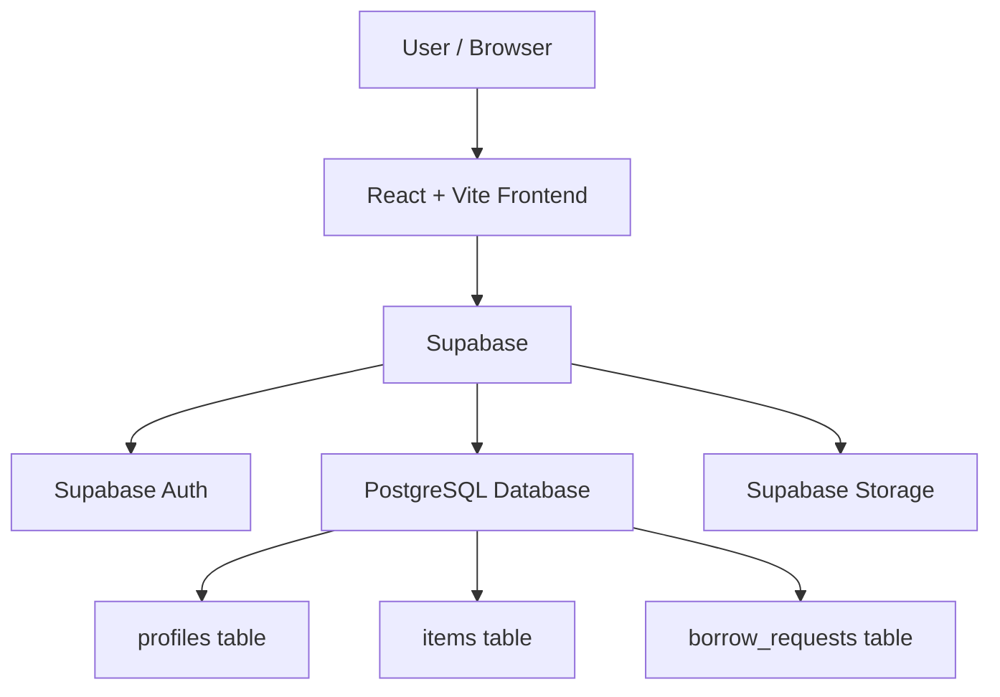

# 📦 BorrowBox

## Borrow. Lend. Return. Build a Smarter Campus Community.

BorrowBox is a campus-based item-sharing platform that lets students list items they own but rarely use, and discover items they need temporarily — without buying anything new. From scientific calculators to chargers, books to sports gear, BorrowBox creates a trusted, structured borrowing ecosystem right within your campus community.

> 💻 **GitHub Repository:** https://github.com/Mastermrohit/borrowbox/

---

## ❌ The Problem

Students frequently need items for short periods — for an exam, a project, or a one-off event — but face real friction:

- ❌ Buying a temporary-use item is expensive and wasteful
- ❌ Useful items sit idle with owners who rarely need them
- ❌ Students have no way to discover who has what on campus
- ❌ Informal borrowing over messages is unstructured and hard to track
- ❌ There is no accountability system for lending and returning items

---

## ✅ The Solution

BorrowBox gives every student two roles simultaneously — **lender** and **borrower**.

- **List** items you own and rarely use
- **Browse** available items posted by other students
- **Request** to borrow an item with an optional message
- **Manage** incoming and outgoing requests from a personal dashboard
- **Confirm** hand-offs and returns with a structured approval workflow
- **Re-borrow** items after they are returned — full repeat borrowing is supported

---

## 🔄 How BorrowBox Works

```
Student owns an item they rarely use
              ↓
     Lists it on BorrowBox
     (title, description, category, type, photo)
              ↓
   Another student discovers the item
   (via browse, search, or filters)
              ↓
     Sends a borrow request
     (with optional message to lender)
              ↓
     Owner reviews the request
     in their Request Inbox
              ↓
     Owner approves the request
              ↓
  Owner confirms physical hand-off
  (item is now marked as Borrowed)
              ↓
   Borrower uses the item
              ↓
  Borrower initiates return request
              ↓
  Owner confirms item received
              ↓
  Item becomes Available again
  for the next borrower
```

---

## ✨ Key Features

### 🔐 Authentication
Secure email/password sign-up and login powered by Supabase Auth. Sessions persist across page refreshes. Protected routes redirect unauthenticated users to login.

### 📦 Item Listings
Any authenticated user can post an item to lend or donate. Each listing includes a title, description, category, type (Lend / Donate), and an optional photo upload stored in Supabase Storage.

### 🔍 Browse, Search & Filter
The Browse page shows all currently available items in a responsive grid. Items can be filtered in real time by:
- **Keyword search** — matches title and description
- **Category** — Books, Electronics, Clothing, Furniture, Sports, Other
- **Type** — Lend or Donate

### 🤝 Borrow Requests
Any logged-in student (who is not the owner) can send a borrow request from the item detail page, with an optional note for the lender. Duplicate active requests for the same item are prevented.

### ✅ Request Approval & Rejection
Owners see all incoming requests in their **Request Inbox** dashboard tab. They can approve or reject each request individually.

### 🤲 Hand-off Confirmation
After approving a request, the owner confirms the physical hand-off with a **"Confirm Hand-off"** button. This moves the request to `borrowed` status, clearly marking that the item is now in the borrower's possession.

### ↩️ Return Workflow
When the borrower is ready to return the item, they click **"Request Return"** in their **My Requests** tab. The owner then confirms physical receipt via **"Confirm Return Received"** in their inbox. The request status moves to `returned` and the item automatically becomes available again.

### 🔄 Repeat Borrowing
Once a request reaches `returned` status, it is treated as completed history. The same borrower — or any other student — can request the item again immediately. Full borrowing history is preserved.

### 🗂️ Personal Dashboard
Every user has a three-tab dashboard:
- **My Listings** — manage posted items, delete listings, or manually mark items as returned
- **Request Inbox** — review and act on incoming borrow requests
- **My Requests** — track the status of all outgoing borrow requests

---

## 🔁 Complete Borrowing Lifecycle

```
📦 Available
      ↓  (borrower sends request)
⏳ Pending
      ↓  (owner approves)
✅ Approved
      ↓  (owner confirms physical hand-off)
📚 Borrowed
      ↓  (borrower requests return)
↩️  Return Requested
      ↓  (owner confirms receipt)
✔️  Returned
      ↓  (item automatically resets)
📦 Available Again
```

**All historical request records are preserved.** Each borrow event creates a new record, so a complete borrowing history exists per item.

| Status | Who acts | Description |
|---|---|---|
| `pending` | — | Request created, awaiting owner review |
| `approved` | Owner | Owner approved the request |
| `borrowed` | Owner | Physical hand-off confirmed |
| `return_requested` | Borrower | Borrower initiated return |
| `returned` | Owner | Owner confirmed item received |
| `rejected` | Owner | Request declined |

---

## 📸 Screenshots

> Add screenshots to a `/screenshots` folder in the repository and update the paths below.

| Screen | Preview |
|---|---|
| Browse Items | `` |
| Item Detail | `` |
| Post Item | `` |
| Request Inbox (Owner) | `` |
| My Requests (Borrower) | `` |
| Return Flow | `` |

---

## 🛠️ Tech Stack

| Technology | Purpose |
|---|---|
| React 19 | Frontend UI framework |
| React Router v7 | Client-side routing |
| Tailwind CSS v4 | Utility-first styling |
| Vite | Development server and build tool |
| Supabase Auth | Email/password authentication and session management |
| Supabase Database | PostgreSQL — items, borrow requests, user profiles |
| Supabase Storage | Item image uploads |
| Supabase RLS | Row-Level Security — per-user data access policies |

---

## 🏗️ System Architecture



**Database Tables:**

| Table | Purpose |
|---|---|
| `profiles` | Stores username and campus info per user |
| `items` | Item listings with title, category, type, status, image |
| `borrow_requests` | Full borrow lifecycle records with status and timestamps |

Row-Level Security policies ensure users can only read and modify their own data.

---

## 🚀 Getting Started

### Prerequisites

- Node.js 18+
- A [Supabase](https://supabase.com) project with the schema applied

### 1. Clone the repository

```bash
git clone <repository-url>
cd borrowbox
```

### 2. Install dependencies

```bash
npm install
```

### 3. Configure environment variables

Create a `.env.local` file in the project root:

```env
VITE_SUPABASE_URL=your_supabase_project_url
VITE_SUPABASE_ANON_KEY=your_supabase_anon_key
```

Find these values in your Supabase dashboard under **Project Settings → API**.

### 4. Apply the database schema

Run the contents of `supabase/schema.sql` in your **Supabase SQL Editor**.

Then create the `item-images` storage bucket manually:
1. Go to **Storage** in your Supabase dashboard
2. Click **New bucket**, name it `item-images`, enable **Public bucket**
3. Apply the storage policies listed in the comments at the top of `supabase/schema.sql`

### 5. Start the development server

```bash
npm run dev
```

The app will be available at `http://localhost:5173`.

---

## 🌐 Deployment

BorrowBox is a standard Vite + React SPA and can be deployed to any static hosting platform.

**Recommended: [Vercel](https://vercel.com)**

1. Push the repository to GitHub
2. Import the project into Vercel
3. Add the environment variables (`VITE_SUPABASE_URL`, `VITE_SUPABASE_ANON_KEY`) in the Vercel project settings
4. Deploy — Vercel auto-detects Vite and builds correctly

> 🚀 Live prototype: [ADD LIVE DEMO LINK HERE]

---

## 🧪 Testing the Core Workflow

Use this checklist to verify the full prototype end-to-end:

### Authentication
- [ ] Sign up with a new email
- [ ] Log in with existing credentials
- [ ] Refresh the page — session persists
- [ ] Sign out and verify protected pages redirect to login

### Item Management
- [ ] Post a new item (with and without a photo)
- [ ] Verify it appears on the Browse page
- [ ] Browse items as a guest (no login required)
- [ ] Search by keyword
- [ ] Filter by category
- [ ] Filter by type (Lend / Donate)
- [ ] Open an item detail page

### Full Borrowing Lifecycle
- [ ] Log in as User A — post an item
- [ ] Log in as User B — find and open the item
- [ ] User B sends a borrow request
- [ ] Log in as User A — go to Dashboard → Request Inbox
- [ ] User A approves the request
- [ ] User A clicks **Confirm Hand-off** — item status becomes `borrowed`
- [ ] Log in as User B — go to Dashboard → My Requests
- [ ] User B clicks **Request Return**
- [ ] Log in as User A — go to Request Inbox
- [ ] User A clicks **Confirm Return Received**
- [ ] Verify item is `available` again on the Browse page
- [ ] Verify both borrow request records exist in history

### Repeat Borrowing
- [ ] As User B, open the same item again
- [ ] Verify the **Send Request** form is shown (not blocked)
- [ ] Send a new borrow request
- [ ] Verify a second request record is created

### Edge Cases
- [ ] Attempting to request your own item — verify the form is hidden
- [ ] Attempting to send a second request while one is already active — verify it is blocked

---

## 🌍 Real-World Use Cases

| Scenario | Example |
|---|---|
| 📚 Exam season | Borrow an engineering textbook for two weeks before exams |
| 🔢 Lab sessions | Borrow a scientific calculator for a mathematics paper |
| 🔌 Emergency | Borrow a charger or power bank between classes |
| ⚽ Practice | Borrow sports equipment for an evening game |
| 🔧 Project work | Borrow tools or components for a hardware project |
| 📷 Campus event | Borrow a camera or tripod for a college event |
| 💡 Short-term tech | Borrow a USB hub, adapter, or peripheral for a day |

---

## 🔮 Future Scope

The following are potential future enhancements. **None of these are currently implemented in this prototype.**

- 🏫 **Campus/college email verification** — restrict access to verified students
- ⭐ **Trust scores and ratings** — borrowers and lenders rate each experience
- 💬 **In-app messaging** — direct chat between borrower and lender
- 📸 **Damage reporting** — borrowers can flag item condition on return
- ⏰ **Return reminders** — automated nudges for overdue items
- 📱 **Push notifications** — real-time alerts for request updates
- 🏫 **Multi-campus support** — expand across institutions
- 🔖 **Item wishlist** — get notified when a specific item becomes available
- 📊 **Analytics dashboard** — track lending activity and popular items

---

## 👨‍💻 Built At

> BorrowBox — Hackathon MVP
>
> *Built to reduce waste, reduce cost, and build community — one borrowed item at a time.*

# 📦 BorrowBox

## Borrow. Lend. Return. Build a Smarter Campus Community.

BorrowBox is a campus-based item-sharing platform that lets students list items they own but rarely use, and discover items they need temporarily — without buying anything new. From scientific calculators to chargers, books to sports gear, BorrowBox creates a trusted, structured borrowing ecosystem right within your campus community.

> 🚀 **Live Demo:** [ADD LIVE DEMO LINK HERE]
>
> 💻 **GitHub Repository:** [ADD REPOSITORY LINK HERE]

---

## ❌ The Problem

Students frequently need items for short periods — for an exam, a project, or a one-off event — but face real friction:

- ❌ Buying a temporary-use item is expensive and wasteful
- ❌ Useful items sit idle with owners who rarely need them
- ❌ Students have no way to discover who has what on campus
- ❌ Informal borrowing over messages is unstructured and hard to track
- ❌ There is no accountability system for lending and returning items

---

## ✅ The Solution

BorrowBox gives every student two roles simultaneously — **lender** and **borrower**.

- **List** items you own and rarely use
- **Browse** available items posted by other students
- **Request** to borrow an item with an optional message
- **Manage** incoming and outgoing requests from a personal dashboard
- **Confirm** hand-offs and returns with a structured approval workflow
- **Re-borrow** items after they are returned — full repeat borrowing is supported

---

## 🔄 How BorrowBox Works

```
Student owns an item they rarely use
              ↓
     Lists it on BorrowBox
     (title, description, category, type, photo)
              ↓
   Another student discovers the item
   (via browse, search, or filters)
              ↓
     Sends a borrow request
     (with optional message to lender)
              ↓
     Owner reviews the request
     in their Request Inbox
              ↓
     Owner approves the request
              ↓
  Owner confirms physical hand-off
  (item is now marked as Borrowed)
              ↓
   Borrower uses the item
              ↓
  Borrower initiates return request
              ↓
  Owner confirms item received
              ↓
  Item becomes Available again
  for the next borrower
```

---

## ✨ Key Features

### 🔐 Authentication
Secure email/password sign-up and login powered by Supabase Auth. Sessions persist across page refreshes. Protected routes redirect unauthenticated users to login.

### 📦 Item Listings
Any authenticated user can post an item to lend or donate. Each listing includes a title, description, category, type (Lend / Donate), and an optional photo upload stored in Supabase Storage.

### 🔍 Browse, Search & Filter
The Browse page shows all currently available items in a responsive grid. Items can be filtered in real time by:
- **Keyword search** — matches title and description
- **Category** — Books, Electronics, Clothing, Furniture, Sports, Other
- **Type** — Lend or Donate

### 🤝 Borrow Requests
Any logged-in student (who is not the owner) can send a borrow request from the item detail page, with an optional note for the lender. Duplicate active requests for the same item are prevented.

### ✅ Request Approval & Rejection
Owners see all incoming requests in their **Request Inbox** dashboard tab. They can approve or reject each request individually.

### 🤲 Hand-off Confirmation
After approving a request, the owner confirms the physical hand-off with a **"Confirm Hand-off"** button. This moves the request to `borrowed` status, clearly marking that the item is now in the borrower's possession.

### ↩️ Return Workflow
When the borrower is ready to return the item, they click **"Request Return"** in their **My Requests** tab. The owner then confirms physical receipt via **"Confirm Return Received"** in their inbox. The request status moves to `returned` and the item automatically becomes available again.

### 🔄 Repeat Borrowing
Once a request reaches `returned` status, it is treated as completed history. The same borrower — or any other student — can request the item again immediately. Full borrowing history is preserved.

### 🗂️ Personal Dashboard
Every user has a three-tab dashboard:
- **My Listings** — manage posted items, delete listings, or manually mark items as returned
- **Request Inbox** — review and act on incoming borrow requests
- **My Requests** — track the status of all outgoing borrow requests

---

## 🔁 Complete Borrowing Lifecycle

```
📦 Available
      ↓  (borrower sends request)
⏳ Pending
      ↓  (owner approves)
✅ Approved
      ↓  (owner confirms physical hand-off)
📚 Borrowed
      ↓  (borrower requests return)
↩️  Return Requested
      ↓  (owner confirms receipt)
✔️  Returned
      ↓  (item automatically resets)
📦 Available Again
```

**All historical request records are preserved.** Each borrow event creates a new record, so a complete borrowing history exists per item.

| Status | Who acts | Description |
|---|---|---|
| `pending` | — | Request created, awaiting owner review |
| `approved` | Owner | Owner approved the request |
| `borrowed` | Owner | Physical hand-off confirmed |
| `return_requested` | Borrower | Borrower initiated return |
| `returned` | Owner | Owner confirmed item received |
| `rejected` | Owner | Request declined |

---

## 📸 Screenshots

> Add screenshots to a `/screenshots` folder in the repository and update the paths below.

| Screen | Preview |
|---|---|
| Browse Items | `` |
| Item Detail | `` |
| Post Item | `` |
| Request Inbox (Owner) | `` |
| My Requests (Borrower) | `` |
| Return Flow | `` |

---

## 🛠️ Tech Stack

| Technology | Purpose |
|---|---|
| React 19 | Frontend UI framework |
| React Router v7 | Client-side routing |
| Tailwind CSS v4 | Utility-first styling |
| Vite | Development server and build tool |
| Supabase Auth | Email/password authentication and session management |
| Supabase Database | PostgreSQL — items, borrow requests, user profiles |
| Supabase Storage | Item image uploads |
| Supabase RLS | Row-Level Security — per-user data access policies |

---

## 🏗️ System Architecture


**Database Tables:**

| Table | Purpose |
|---|---|
| `profiles` | Stores username and campus info per user |
| `items` | Item listings with title, category, type, status, image |
| `borrow_requests` | Full borrow lifecycle records with status and timestamps |

Row-Level Security policies ensure users can only read and modify their own data.

---

## 🚀 Getting Started

### Prerequisites

- Node.js 18+
- A [Supabase](https://supabase.com) project with the schema applied

### 1. Clone the repository

```bash
git clone <repository-url>
cd borrowbox
```

### 2. Install dependencies

```bash
npm install
```

### 3. Configure environment variables

Create a `.env.local` file in the project root:

```env
VITE_SUPABASE_URL=your_supabase_project_url
VITE_SUPABASE_ANON_KEY=your_supabase_anon_key
```

Find these values in your Supabase dashboard under **Project Settings → API**.

### 4. Apply the database schema

Run the contents of `supabase/schema.sql` in your **Supabase SQL Editor**.

Then create the `item-images` storage bucket manually:
1. Go to **Storage** in your Supabase dashboard
2. Click **New bucket**, name it `item-images`, enable **Public bucket**
3. Apply the storage policies listed in the comments at the top of `supabase/schema.sql`

### 5. Start the development server

```bash
npm run dev
```

The app will be available at `http://localhost:5173`.

---

## 🌐 Deployment

BorrowBox is a standard Vite + React SPA and can be deployed to any static hosting platform.

**Recommended: [Vercel](https://vercel.com)**

1. Push the repository to GitHub
2. Import the project into Vercel
3. Add the environment variables (`VITE_SUPABASE_URL`, `VITE_SUPABASE_ANON_KEY`) in the Vercel project settings
4. Deploy — Vercel auto-detects Vite and builds correctly

> 🚀 Live prototype: [ADD LIVE DEMO LINK HERE]

---

## 🧪 Testing the Core Workflow

Use this checklist to verify the full prototype end-to-end:

### Authentication
- [ ] Sign up with a new email
- [ ] Log in with existing credentials
- [ ] Refresh the page — session persists
- [ ] Sign out and verify protected pages redirect to login

### Item Management
- [ ] Post a new item (with and without a photo)
- [ ] Verify it appears on the Browse page
- [ ] Browse items as a guest (no login required)
- [ ] Search by keyword
- [ ] Filter by category
- [ ] Filter by type (Lend / Donate)
- [ ] Open an item detail page

### Full Borrowing Lifecycle
- [ ] Log in as User A — post an item
- [ ] Log in as User B — find and open the item
- [ ] User B sends a borrow request
- [ ] Log in as User A — go to Dashboard → Request Inbox
- [ ] User A approves the request
- [ ] User A clicks **Confirm Hand-off** — item status becomes `borrowed`
- [ ] Log in as User B — go to Dashboard → My Requests
- [ ] User B clicks **Request Return**
- [ ] Log in as User A — go to Request Inbox
- [ ] User A clicks **Confirm Return Received**
- [ ] Verify item is `available` again on the Browse page
- [ ] Verify both borrow request records exist in history

### Repeat Borrowing
- [ ] As User B, open the same item again
- [ ] Verify the **Send Request** form is shown (not blocked)
- [ ] Send a new borrow request
- [ ] Verify a second request record is created

### Edge Cases
- [ ] Attempting to request your own item — verify the form is hidden
- [ ] Attempting to send a second request while one is already active — verify it is blocked

---

## 🌍 Real-World Use Cases

| Scenario | Example |
|---|---|
| 📚 Exam season | Borrow an engineering textbook for two weeks before exams |
| 🔢 Lab sessions | Borrow a scientific calculator for a mathematics paper |
| 🔌 Emergency | Borrow a charger or power bank between classes |
| ⚽ Practice | Borrow sports equipment for an evening game |
| 🔧 Project work | Borrow tools or components for a hardware project |
| 📷 Campus event | Borrow a camera or tripod for a college event |
| 💡 Short-term tech | Borrow a USB hub, adapter, or peripheral for a day |

---

## 🔮 Future Scope

The following are potential future enhancements. **None of these are currently implemented in this prototype.**

- 🏫 **Campus/college email verification** — restrict access to verified students
- ⭐ **Trust scores and ratings** — borrowers and lenders rate each experience
- 💬 **In-app messaging** — direct chat between borrower and lender
- 📸 **Damage reporting** — borrowers can flag item condition on return
- ⏰ **Return reminders** — automated nudges for overdue items
- 📱 **Push notifications** — real-time alerts for request updates
- 🏫 **Multi-campus support** — expand across institutions
- 🔖 **Item wishlist** — get notified when a specific item becomes available
- 📊 **Analytics dashboard** — track lending activity and popular items

---

## 👨‍💻 Built At

> BorrowBox — Hackathon MVP
>
> *Built to reduce waste, reduce cost, and build community — one borrowed item at a time.*
